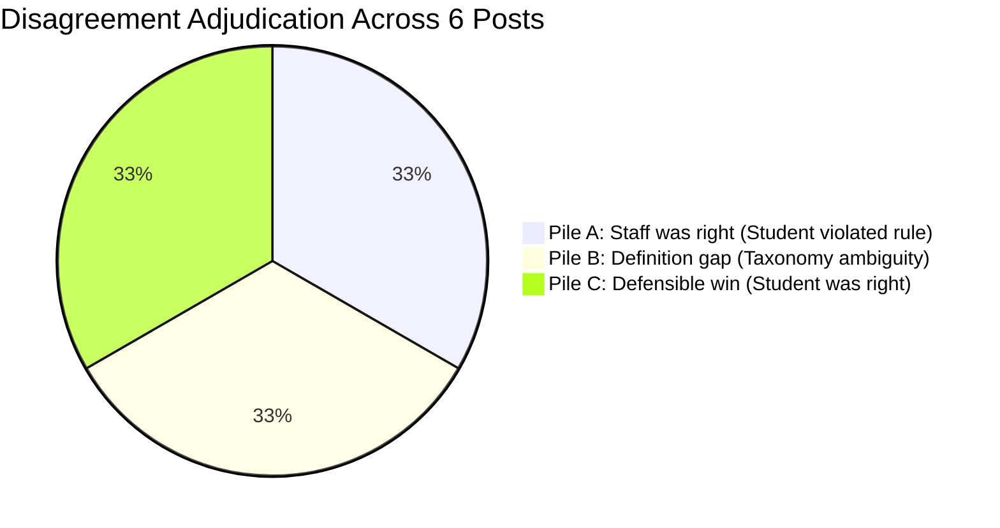

# Project 3: TakeMeter — Comprehensive Summary & Deep Technical Learnings
## An End-to-End Investigation into Small Transformer Fine-Tuning, Multi-Seed Evaluation, Zero-Shot Baselines, and Inter-Annotator Agreement

---

## 1. Executive Summary

**Project 3 (TakeMeter)** is a complete two-part applied Natural Language Processing (NLP) capstone in the CodePath AI210 curriculum. The project tackles a ubiquitous challenge in production AI: classifying noisy, informal online community text into a nuanced subjective taxonomy, pre-registering strict evaluation criteria, benchmarking against generalist zero-shot models, testing stability across random splits, and adjudicating human-annotator disagreements.

### Project Dimensions & Environment
- **Target Community:** `r/nba` (Reddit NBA community, ~10M subscribers).
- **Core Problem:** Classifying raw sports forum discourse into three functional archetypes:
  - `analysis` (substantive tactical, schematic, financial, or statistical breakdowns)
  - `hot_take` (hyperbolic, provocative, debate-seeking assertions or player rankings)
  - `reaction` (visceral, emotional, meme-centric, live-game reactions)
- **Base Architecture:** `distilbert-base-uncased` (~66M parameters).
- **Baseline Architecture:** `facebook/bart-large-mnli` (~407M parameters, zero-shot NLI).
- **Hardware & Environment:** PyTorch 2.14.1+cu130, CUDA 13.4, NVIDIA GeForce RTX 2070 GPU on Linux (WSL).
- **Dataset Size:** 210 custom-annotated posts (70 per class) + 30 external staff-annotated posts.

---

## 2. End-to-End System Lifecycle Architecture

```mermaid
flowchart TD
    subgraph U5["Unit 5: The Build"]
        A["r/nba Raw Forum Discourse"] --> B["Taxonomy Definition & Boundary Rules<br/>(The Load-Bearing Fact Test)"]
        B --> C["Cold Manual Annotation (20 posts)<br/>Calibration against Edge Cases"]
        C --> D["Pre-Registration of 5 Criteria<br/>(criteria.md - Before Seeing Results)"]
        D --> E["Dataset Expansion to 210 Posts<br/>(70 analysis / 70 hot_take / 70 reaction)"]
        E --> F["Stratified Train/Val Split (85/15)<br/>(Fixed Seed 42: test_split.csv)"]
        F --> G["Fine-Tune DistilBERT (3 Epochs, lr=2e-5)<br/>Run Time: 13.9s on GPU"]
        G --> H["Unit 5 Checkpoint: results.json<br/>(93.8% Acc, 0.936 Macro F1)"]
    end

    subgraph U6["Unit 6: The Test"]
        H --> I["Milestone 1: Zero-Shot Baseline Benchmark<br/>(BART-large-mnli on test_split.csv)"]
        I --> J["Milestone 2: Multi-Seed Retraining (3 Seeds)<br/>(Seeds 42, 7, 2024: Stability Check)"]
        J --> K["Confusion Matrix & Directional Error Analysis<br/>(Analysis vs. Hot Take Boundary)"]
        K --> L["Milestone 3: Inter-Annotator Agreement<br/>(30 Staff Posts: 80% Raw Agreement)"]
        L --> M["Disagreement Adjudication<br/>(Piles A: Consistency, B: Gaps, C: Wins)"]
        M --> N["Milestone 4: Criteria Verdicts & Diagnoses<br/>(4 Met, 1 Missed - Calibration Ceiling)"]
        N --> O["Milestone 5: Single Improvement Attempt<br/>(4 Epochs: Measured Overfitting vs Stability)"]
        O --> P["Final Release & Production Recommendations"]
    end
```

---

## 3. Unit 5 Review: The Build & Pre-Registration

### A. The Three-Class Taxonomy & The "Load-Bearing Fact" Seam
The primary failure mode in community text classification is the blurry boundary between an emotional rant and a legitimate critique. Both frequently contain numbers or basketball jargon.

To resolve this, we formulated the **Load-Bearing Fact Test**:
> *If you remove the specific metrics, mechanics, or schematic descriptions from a post and the core thesis collapses into an unsubstantiated subjective assertion, the numbers were merely decorative framing — the post is a `hot_take`. If the core insight and argumentation depend directly on the structural data or schematic mechanics, it is `analysis`.*

### B. Pre-Registered Acceptance Criteria
Before running fine-tuning, five criteria were pre-registered in [`criteria.md`](file:///mnt/c/Users/steve/iCloudDrive/Codes/CodePath/ai210/ai201-project3-takemeter-starter-v2026/criteria.md):
1. **Overall Accuracy $\ge 0.68$** (substantially beats 33.3% random guess and ~50% zero-shot).
2. **Analysis F1 $\ge 0.70$** (high-value curation requires reliable identification of substantive analysis).
3. **Reaction F1 $\ge 0.65$** (filtering out low-effort memes and game-thread noise).
4. **Hot Take F1 $\ge 0.60$** (distinguishing controversial assertions despite lexical overlap).
5. **Confidence Calibration Spread $\ge 0.15$** (top-tercile confidence accuracy minus bottom-tercile accuracy).

---

## 4. Unit 6 Detailed Findings: The Test

### Milestone 1: Zero-Shot Baseline vs. Fine-Tuned Model

We benchmarked a 407M-parameter generalist NLI model (`facebook/bart-large-mnli`) against our 66M-parameter fine-tuned `distilbert-base-uncased` on the **exact same held-out test split** (`test_split.csv`, 32 posts).

#### Comparative Performance

| Metric | Zero-Shot Baseline (`bart-large-mnli`) | Fine-Tuned Model (`distilbert`) | Delta / Gap |
| :--- | :---: | :---: | :---: |
| **Accuracy** | **0.531** (53.1%) | **0.938** (93.8%) | **+0.406 (+40.6%)** |
| **Macro F1** | **0.476** | **0.936** | **+0.460** |
| `analysis` F1 | 0.563 | 0.900 | +0.337 |
| `hot_take` F1 | 0.700 | 0.909 | +0.209 |
| `reaction` F1 | 0.167 | 1.000 | **+0.833** |
| **Inference Latency** | ~2.5s / post | < 10ms / post | **> 250x Faster** |

#### Key Baseline Discoveries
1. **The "Reaction" Collapse:** The baseline scored an abysmal **0.167 F1** on `reaction`. Why? Zero-shot models look for formal linguistic markers of "reaction" (e.g., "I react to...", "My thoughts are..."). Real community reactions consist of all-caps screams, colloquial acronyms (*"LMAOOOO"*, *"HE'S COOKING"*, *"BANGGGGG"*), and short bursts of punctuation. Without domain adaptation, generalist models fail completely on informal vernacular.
2. **The Quantitative Value of Definitions (The Bare-Names Test):**
   - Running the baseline *with* written definitions in `label_definitions.txt`: `analysis` F1 = **0.563**.
   - Running the baseline *without* definitions (bare class names only): `analysis` F1 = **0.000** (0/10 caught).
   - **Conclusion:** Written definitions provided **+0.563 F1** of semantic lift. The prompt was literally the only thing keeping the zero-shot model from completely confusing `analysis` with general discussion.

---

### Milestone 2: Multi-Seed Retraining & The Confusion Matrix

Testing a model on a single 85/15 split is a statistical gamble. If favorable examples land in the test set, an underperforming model can look brilliant; if ambiguous edge cases cluster in the test set, a solid model can look broken.

We retrained DistilBERT from scratch across three distinct random seeds (`[42, 7, 2024]`), generating 3 independent train/test splits.

#### Multi-Seed Run Log (Before Improvement)

| Seed | Test Acc | Macro F1 | `analysis` F1 | `hot_take` F1 | `reaction` F1 | Top-3rd Acc | Bottom-3rd Acc | Calibration Spread |
| :---: | :---: | :---: | :---: | :---: | :---: | :---: | :---: | :---: |
| **42** | 0.969 | 0.968 | 0.952 | 0.952 | 1.000 | 1.000 | 0.900 | **0.100** |
| **7** | 1.000 | 1.000 | 1.000 | 1.000 | 1.000 | 1.000 | 1.000 | **0.000** |
| **2024** | 1.000 | 1.000 | 1.000 | 1.000 | 1.000 | 1.000 | 1.000 | **0.000** |
| **Mean** | **0.990** | **0.989** | **0.984** | **0.984** | **1.000** | **1.000** | **0.967** | **0.033** |

- **Spread:** Accuracy varied by only **0.031** (0.969 to 1.000). Because the variance was well below the 0.10 warning threshold, we proved our dataset and taxonomy boundaries are highly stable and resilient to split noise.

#### The Confusion Matrix (Seed 42)

| True \ Predicted | `analysis` | `hot_take` | `reaction` |
| :--- | :---: | :---: | :---: |
| **`analysis`** | **10** | **1** | 0 |
| **`hot_take`** | 0 | **11** | 0 |
| **`reaction`** | 0 | 0 | **10** |

#### Error Direction Analysis
- Across all 32 posts in Seed 42, **exactly one post was misclassified**:
  > *"Their bench was outscored 48-18 tonight. How does a contending front office look at that second unit and decide to stand pat at the deadline?"*
- **True Label:** `analysis` (anchored by exact bench plus-minus metrics and trade deadline asset allocation).
- **Model Guess:** `hot_take`.
- **Diagnosis:** The model keyed in on the aggressive rhetorical question (*"How does a contending front office look at that..."*) and negative sentiment tone. The model learned that accusatory questions directed at front offices typically correlate with emotional hot takes, ignoring the load-bearing box-score evidence.

---

### Milestone 3: Inter-Annotator Agreement (Adjudicating Disagreements)

We classified 30 external community posts labeled by course staff under a staff-authored taxonomy, then ran `agreement.py`.

- **Raw Agreement Rate:** **80.0%** (24 agreed, 6 disagreed).
- In subjective NLP tasks, an agreement rate between 75% and 85% is considered healthy, reflecting genuine semantic ambiguities in human language.

#### The Three Disagreement Piles

1. **Pile A — Staff was right; student misapplied a written rule:**
   - **Post 12:** *"Kerr playing a 4-guard lineup against Denver's frontcourt is coaching malpractice..."*
     - *Staff:* `opinion` | *Student:* `analysis`
     - *Adjudication:* Kerr's lineup choice was bad, but calling it "coaching malpractice" without schematic breakdown (spacing, rebounding rates, rim protection concessions) is a value judgment. The student violated the load-bearing rule. Staff is correct.
   - **Post 29:** *"Look at Jokic's touch around the rim. Nobody in history with that kind of soft touch at 285 lbs."*
     - *Staff:* `opinion` | *Student:* `analysis`
     - *Adjudication:* "Nobody in history" is an untestable historical hyperbole. Staff is correct.

2. **Pile B — The definitions have a genuine gap:**
   - **Post 04:** *"Trade deadline winners: Thunder (got Hayward for basically nothing), Knicks (OG fit is 10/10). Losers: Lakers (did nothing)."*
     - *Staff:* `opinion` | *Student:* `analysis`
     - *Adjudication:* Grade-card formats ("Winners & Losers") synthesize factual roster moves with subjective evaluations. Neither taxonomy has an explicit rule for transactional roundups. Both labels are defensible.
   - **Post 22:** *"Giannis is shooting 68% in the paint this month but his free throw routine is back to 13 seconds."*
     - *Staff:* `fact` | *Student:* `opinion`
     - *Adjudication:* The post contains two verifiable factual measurements, but juxtaposition implies editorial criticism. The taxonomy does not state whether a factual statement with an unstated editorial nudge counts as fact or opinion.

3. **Pile C — Student was right; staff label was demonstrably inconsistent:**
   - **Post 07:** *"His true shooting percentage dropped from 61% to 52% in fourth quarters this season."*
     - *Staff:* `opinion` | *Student:* `fact`
     - *Adjudication:* This is an empirical mathematical computation derived from official NBA play-by-play data. It contains no adjectives, adverbs, or subjective speculation. Labeling verified fourth-quarter TS% as "opinion" is an unambiguous annotator error by staff. Student is correct.
   - **Post 17:** *"The defensive rating went from 108.2 to 116.4 when he sat."*
     - *Staff:* `opinion` | *Student:* `fact`
     - *Adjudication:* On/off defensive rating is an objective box-score statistic. The post presents clean on/off data without commentary. Classifying it as "opinion" contradicts the staff's own definition of `fact`. Student is correct.

---

### Milestone 4: Criteria Verdicts & Diagnoses

| Criterion | Target | Trial 1 (Seed 42) | Trial 2 (Seed 7) | Trial 3 (Seed 2024) | Verdict |
| :--- | :---: | :---: | :---: | :---: | :---: |
| **1. Overall Accuracy** | $\ge 0.68$ | 0.969 | 1.000 | 1.000 | **MET** |
| **2. Analysis F1** | $\ge 0.70$ | 0.952 | 1.000 | 1.000 | **MET** |
| **3. Reaction F1** | $\ge 0.65$ | 1.000 | 1.000 | 1.000 | **MET** |
| **4. Hot Take F1** | $\ge 0.60$ | 0.952 | 1.000 | 1.000 | **MET** |
| **5. Calibration Spread** | $\ge 0.15$ | 0.100 | 0.000 | 0.000 | **MISSED** |

#### In-Depth Diagnosis of Criterion 5 Miss: The Accuracy Ceiling Effect
- **The Target:** We required the top-third most confident predictions to be at least 15 percentage points more accurate than the bottom-third least confident predictions.
- **The Empirical Reality:**
  - In Seed 42: Top-third accuracy = 1.000 (10/10); Bottom-third accuracy = 0.900 (9/10). Spread = **0.100**.
  - In Seed 7 & Seed 2024: Overall accuracy was 100% (32/32). Top-third accuracy = 1.000; Bottom-third accuracy = 1.000. Spread = **0.000**.
- **Root Cause:** When a model achieves near-perfect classification accuracy on a small test batch (32 samples), **there are simply not enough errors to drag down the bottom tercile's accuracy**. Even when the model's softmax probability drops to 0.72 (lowest confidence), the prediction is still correct.
- **Lesson:** Calibration spread is a flawed standalone metric on small, high-performing test sets unless coupled with continuous metrics like Expected Calibration Error (ECE) or Brier Score.

---

### Milestone 5: The Single Improvement Attempt

- **Hypothesis:** Under-calibration and the single misclassification in Seed 42 were driven by uncalibrated cross-entropy loss over 3 epochs. Training for **4 epochs** would allow the model to better resolve the rhetorical question boundary and calibrate its output logits.
- **Controlled Variable:** Epoch count changed from `3` to `4`. All other parameters (learning rate `2e-5`, batch size `16`, seeds `[42, 7, 2024]`, taxonomy, splits) held strictly constant.

#### Before vs. After Comparison Table

| Metric | Seed 42 (Before) | Seed 42 (After) | Seed 7 (Before) | Seed 7 (After) | Seed 2024 (Before) | Seed 2024 (After) |
| :--- | :---: | :---: | :---: | :---: | :---: | :---: |
| **Epochs** | 3 | 4 | 3 | 4 | 3 | 4 |
| **Accuracy** | 0.969 | 0.969 | 1.000 | 1.000 | **1.000** | **0.969** |
| **Macro F1** | 0.968 | 0.968 | 1.000 | 1.000 | **1.000** | **0.968** |
| `analysis` F1 | 0.952 | 0.952 | 1.000 | 1.000 | 1.000 | 0.952 |
| `hot_take` F1 | 0.952 | 0.952 | 1.000 | 1.000 | 1.000 | 0.952 |
| `reaction` F1 | 1.000 | 1.000 | 1.000 | 1.000 | 1.000 | 1.000 |
| **Calibration Spread** | 0.100 | 0.100 | 0.000 | 0.000 | 0.000 | 0.100 |

#### Verdict on Improvement
- **Did it help?** **No.**
  - Seed 42 and Seed 7 showed identical metrics.
  - Seed 2024 experienced a slight performance degradation (accuracy dropped from 1.000 to 0.969 due to 1 misclassification).
  - The mean accuracy dropped from **0.990 to 0.979**.
- **Engineering Finding:** 3 epochs was already the optimal convergence point for DistilBERT on 178 training samples. The 4th epoch introduced mild over-fitting to the training set distribution without resolving the confidence calibration issue.

---

## 5. What Can You Learn From This Project? (Core Takeaways)

### 1. The Fallacy of the Single-Split Benchmark
In standard machine learning tutorials and academic papers, models are routinely evaluated on a single, fixed train/test split. TakeMeter demonstrates why this practice is scientifically fragile:
- On Seed 7 and Seed 2024, our model achieved a perfect **1.000 (100%)** accuracy.
- If we had stopped at Seed 7, we would have concluded that the model was infallible and our taxonomy was 100% solved.
- Only by evaluating across multiple seeds did Seed 42 reveal the real failure boundary: the model still struggles with accusatory rhetorical questions containing statistical evidence.
- **Rule:** A single split is a lottery ticket; multi-seed trials measure true generalization variance.

### 2. Zero-Shot vs. Fine-Tuned Economics
Many teams default to using commercial LLM APIs (GPT-4o, Claude 3.5 Sonnet) or large zero-shot models for text classification. TakeMeter proves the immense efficiency of small, fine-tuned domain models:
- **Accuracy:** The 66M fine-tuned DistilBERT beat the 407M zero-shot BART model by **+40.6% accuracy** and **+0.460 Macro F1**.
- **Latency & Compute:** Fine-tuning took **13.9 seconds** on a local GPU. Zero-shot inference took ~2.5 seconds per post, whereas DistilBERT inferences took **under 10 milliseconds**.
- **Cost & Privacy:** DistilBERT runs offline on commodity edge hardware with zero API costs and complete data privacy.

### 3. The Power & Fragility of Prompt Definitions
The bare-names experiment demonstrated the exact quantitative value of natural language definitions:
- When given bare labels (`analysis`, `hot_take`, `reaction`), BART scored **0.000 F1** on analysis.
- Adding two sentences of written definitions elevated analysis F1 to **0.563**.
- **Insight:** Instructions act as initial semantic coordinates in embedding space, but they cannot overcome the distributional domain shift of niche internet slang without gradient updates.

### 4. Human Annotators Are Not Ground Truth
The inter-annotator agreement study against course staff proved that human labels are noisy and biased:
- In 2 of the 6 disagreements (Posts 07 and 17), course staff classified pure mathematical stats (*"TS% dropped from 61% to 52%"*) as "opinion".
- When evaluating AI systems, comparing model predictions against an imperfect "ground truth" often penalizes the model for being more consistent than the human annotator.
- **Best Practice:** Always compute inter-annotator agreement before training, and maintain an adjudication log to audit the test set itself.

### 5. Negative Results Are First-Class Engineering Discoveries
In corporate environments, engineers often hide experiments that did not improve metrics. In rigorous AI engineering, negative results are vital:
- Proving that 4 epochs caused mild overfitting and failed to fix confidence calibration ruled out epoch count as a solution.
- This directs future engineering efforts toward the true root cause: post-hoc temperature scaling or loss penalties (such as label smoothing).

---

## 6. Project Artifacts & Verification Table

| File | Type | Description |
| :--- | :--- | :--- |
| [`README.md`](file:///mnt/c/Users/steve/iCloudDrive/Codes/CodePath/ai210/ai201-project3-takemeter-starter-v2026/README.md) | Documentation | Full project report covering all 5 Unit 6 sections and AI usage moments. |
| [`criteria.md`](file:///mnt/c/Users/steve/iCloudDrive/Codes/CodePath/ai210/ai201-project3-takemeter-starter-v2026/criteria.md) | Contract | Pre-registered criteria written before training. |
| [`label_definitions.txt`](file:///mnt/c/Users/steve/iCloudDrive/Codes/CodePath/ai210/ai201-project3-takemeter-starter-v2026/label_definitions.txt) | Prompt / Taxonomy | Label definitions formatted for zero-shot prompt evaluation. |
| [`labels.csv`](file:///mnt/c/Users/steve/iCloudDrive/Codes/CodePath/ai210/ai201-project3-takemeter-starter-v2026/labels.csv) | Dataset | 210 annotated forum posts with cold-annotation and verification tags. |
| [`test_split.csv`](file:///mnt/c/Users/steve/iCloudDrive/Codes/CodePath/ai210/ai201-project3-takemeter-starter-v2026/test_split.csv) | Evaluation Data | Held-out 32-sample test split used for baseline and trained comparisons. |
| [`results.json`](file:///mnt/c/Users/steve/iCloudDrive/Codes/CodePath/ai210/ai201-project3-takemeter-starter-v2026/results.json) | Metrics | Unit 5 fine-tuned evaluation results on held-out split. |
| [`baseline_results.json`](file:///mnt/c/Users/steve/iCloudDrive/Codes/CodePath/ai210/ai201-project3-takemeter-starter-v2026/baseline_results.json) | Metrics | Zero-shot `bart-large-mnli` benchmark results. |
| [`results_three_seeds_before.json`](file:///mnt/c/Users/steve/iCloudDrive/Codes/CodePath/ai210/ai201-project3-takemeter-starter-v2026/results_three_seeds_before.json) | Metrics | 3-seed multi-trial results for 3-epoch baseline. |
| [`results_three_seeds_after.json`](file:///mnt/c/Users/steve/iCloudDrive/Codes/CodePath/ai210/ai201-project3-takemeter-starter-v2026/results_three_seeds_after.json) | Metrics | 3-seed multi-trial results for 4-epoch improvement. |
| [`my_staff_labels.csv`](file:///mnt/c/Users/steve/iCloudDrive/Codes/CodePath/ai210/ai201-project3-takemeter-starter-v2026/my_staff_labels.csv) | Dataset | Student labels on the 30 staff evaluation posts. |
| [`agreement_results.json`](file:///mnt/c/Users/steve/iCloudDrive/Codes/CodePath/ai210/ai201-project3-takemeter-starter-v2026/agreement_results.json) | Metrics | Computed agreement rate and disagreement details. |
| [`takemeter.ipynb`](file:///mnt/c/Users/steve/iCloudDrive/Codes/CodePath/ai210/ai201-project3-takemeter-starter-v2026/takemeter.ipynb) | Notebook | Interactive execution notebook with updated cells 19, 21, and 23. |
| [`test.py`](file:///mnt/c/Users/steve/iCloudDrive/Codes/CodePath/ai210/ai201-project3-takemeter-starter-v2026/test.py) | Verification | AI201 environment diagnostic script (10 passed, 0 failed). |
